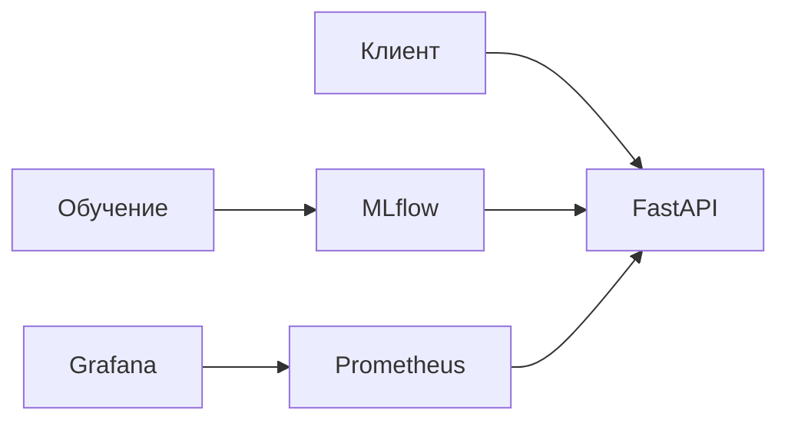

# Детектор ботов в диалогах

Соревнование «You are bot»

Михаил Акмурзин

---

# Задача

Дан диалог двух участников. Для каждого участника нужно предсказать вероятность того, что он бот.

**Пример**:

```text
0: Привет, как дела?
1: Привет! У меня всё отлично, спасибо, что спросил! Чем могу помочь?
0: ты бот?
```

**Метрика**: LogLoss, ROC-AUC, F1


---

# Данные

| | train | test |
|---|---|---|
| диалогов | 1 516 | 379 |
| сообщений | 10 490 | 2 837 |
| участников | 3 032 | 758 |

- в диалоге обычно 6 сообщений, реплика около 8 символов
- ботов 41% участников
- в 82% диалогов один бот, в 18% оба человека, двух ботов не бывает
- боты пишут грамотно и по теме, люди коротко, строчными буквами, со сленгом

---

# Фичи-инженеринг

Каждый участник это одна строка. Признаки считаются для него и для собеседника.

- статистики текста: длина, доля заглавных, пунктуация, латиница, вопросы, повторы
- эмбеддинги реплик из `rubert-tiny2`:
  - средний эмбеддинг реплик участника
  - сходство реплики с предыдущей репликой собеседника

Текст не чистится: регистр, пунктуация и опечатки сами по себе признак.

---

# Модель

- LightGBM, гиперпараметры подобраны Optuna
- валидация: GroupKFold по диалогам, 5 фолдов

| Метрика | Значение |
|---|---|
| LogLoss | 0.199 |
| ROC-AUC | 0.976 |
| F1 при пороге 0.5 | 0.90 |

---

# Важность признаков

| Группа | Доля gain |
|---|---|
| средний эмбеддинг | 54% |
| сходство с репликой собеседника | 30% |
| статистики текста | 10% |
| число и длина сообщений | 5% |

Самые важные признаки это сходство ответа с репликой собеседника. Боты отвечают по теме чаще людей.

Признаки собеседника дают около 30% от общей важности.

---

# Сервис



- `POST /v1/predict` принимает диалог, возвращает вероятности для обоих участников
- модель хранится в MLflow вместе с энкодером
- сервис раз в 30 секунд проверяет алиас `champion` и подгружает новую версию
- весь стек запускается через `docker compose`, скрипт `deploy.sh`

---

# Мониторинг и проверка

Дашборд в Grafana — [localhost:3000](http://localhost:3000), метрики собирает Prometheus — [localhost:9090](http://localhost:9090):

- число запросов в секунду и ответы по кодам
- задержки p50, p95, p99
- доля ошибок
- время этапов: эмбеддинги, признаки и модель
- распределение предсказанных вероятностей
- версия модели и её перезагрузки

Проверка: ответы сервиса совпадают с предсказаниями при обучении у 97% участников, максимальное расхождение 0.008.

---

# Итоги

- LogLoss 0.199 на кросс-валидации
- основной сигнал это насколько ответ соответствует реплике собеседника
- модель развёрнута как сервис с реестром моделей и мониторингом


